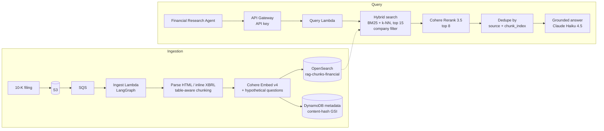

# Financial RAG Pipeline on AWS

The retrieval layer behind the [Financial Research Agent](https://github.com/sudheerch1/financial-research-agent). It ingests SEC 10-K filings (Apple, Microsoft, Amazon), indexes them for **hybrid search**, and serves a company-scoped query API that the agent calls as a tool.

Forked from my [Legal RAG pipeline](https://github.com/sudheerch1/rag-pipeline) and adapted for financial documents, where **tables, exact line-item labels, and closely clustered numbers** break generic RAG.

Decisions are documented in **[8 architecture decision records](ADR/%232-ADR_Financial_RAG_Pipeline.md)**.

---

## Architecture

---

## What's different about financial documents

| Problem | Decision |
|---|---|
| Generic semantic chunking split **table rows mid-figure**, corrupting numbers before indexing | **Table-aware chunking**: table blocks are kept intact (ADR-003) |
| A minimum-token filter written for prose **silently dropped short table labels** (segment names, 1-2 word line items) | Table blocks are **exempt from the MIN_TOKENS filter** (ADR-003) |
| Financial figures **cluster closely in embedding space**, so vector search alone returns plausible but wrong numbers | **Hybrid search**: BM25 (hypothetical questions weighted 2x over raw text) plus k-NN, then **Cohere Rerank 3.5** (ADR-002) |
| Line items are labeled differently across companies ("Total net sales" vs. "Total revenue") | Lexical matching on hypothetical questions plus reranking handles label variation (ADR-002) |
| SEC filings use **inline XBRL**, which a generic file-type detector misclassified | Format detection and parsing adapted for inline XBRL HTML |

---

## Engineering story: the dedup bug that hid behind Apple

The dedup step originally keyed chunks on `source + page`. But `page` was never populated at ingestion, so the key collapsed to `source + None`, and dedup **silently kept just one chunk per company**.

Apple's answers still looked correct, because Apple repeats "Total net sales" in almost every chunk, so whichever chunk survived had the right figure. **Microsoft and Amazon returned wrong or incomplete revenue**, because their correct figures lived in chunks that were being thrown away.

**Fix:** key on `source + chunk_index`, plus a companion fix in `run_search`, which fetched `chunk_index` from OpenSearch but never copied it into the chunk object. Verified end to end with live queries for all three companies (ADR-004).

**Lesson:** an earlier unit test passed because its hand-built test data shared the same wrong assumption about field names. The bug only surfaced when the **real** `run_search -> run_rerank -> run_dedup` functions were chained together on live data.

---

## Infrastructure

- **Full isolation from the Legal pipeline:** separate buckets, index, DynamoDB table, Lambdas, IAM role, and API Gateway. Only the OpenSearch domain is shared, to control cost (ADR-001, 006)
- **OpenSearch fine-grained access control:** explicit per-role mapping for the Financial Lambda role, alongside the Legal mapping (ADR-006)
- **Serverless:** ingest and query Lambdas (Python 3.11), no idle compute between demos (ADR-005)
- **API key enforcement** on the query endpoint, with the key held in SSM Parameter Store (ADR-007)
- **Infrastructure as code:** [`docs/rag-stack.yaml`](docs/rag-stack.yaml) (CloudFormation)
- **Cost control:** OpenSearch is snapshotted to S3 and shut down between demos ([runbook](docs/OpenSearch_Reactivation_Runbook.md))

## Known limitations (POC scope)

- **Single-company filter per query.** Cross-company comparisons are handled by the agent making one call per company (ADR-008)
- **Shared OpenSearch domain** (single node) is a single point of failure for both pipelines (ADR-006)
- **`page` is not populated at ingestion**, so page-level citations aren't available yet (ADR-004)
- **Manual Lambda packaging:** a stale package once shipped, so live code is now verified by download-and-grep after every deploy (ADR-005)

## Tech stack

Python 3.11 | LangGraph | LangChain | Amazon Bedrock (Claude Haiku 4.5, Cohere Embed v4, Cohere Rerank 3.5) | OpenSearch | Lambda | SQS | S3 | DynamoDB | API Gateway | SSM Parameter Store | CloudFormation | LangSmith